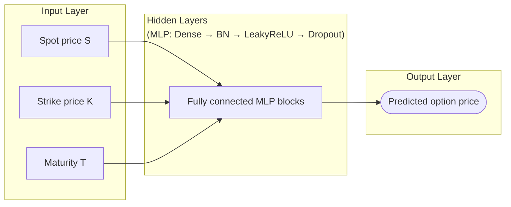

## Deep-Learning Framework for Option Pricing and Hedging

It is essential to examine the fundamental distinction between the classical paradigm (dual martingale representations) and the machine-learning paradigm (primitive functional optimization).
Deep hedging is designed to avoid the need for a unique risk-neutral pricing measure in incomplete markets. 
It directly solves a convex risk-minimization problem using neural-network policies. Rather than eliminating risk-neutral valuation, deep hedging shifts the focus from finding a unique replicating price under a risk-neutral measure to finding a trading strategy that minimizes a specified convex risk measure in an incomplete or frictional market.

We develop the overall methodology in three stages:

**Stage 1 — Deep Option Pricing**
> Learn European call prices using an MLP.
**Stage 2 — Neural Option Greeks**
> Estimate Delta, Gamma, and other sensitivities using automatic differentiation.
**Stage 3 — Deep Dynamic Hedging**
> Develop a neural hedging model and compare its performance with conventional Delta hedging.

### Deep Neural Network for Option Pricing
-----------------------
Objective: Learn the price of an option $(C(S_t, K, T))$ directly from market data

**Model**: Fully Connected Neural Network (MLP)

**Inputs**:  Spot (S), Strike (K), Maturity (T)

**Output**:  European Call Option Price (C)

**Learning formulation**
------------------------
A neural network replaces the closed-form map with a parametric function

$$
C_\theta : \mathbb{R}^3 \to \mathbb{R}_{+}, \qquad \hat{C} = C_\theta(S, K, \tau),
$$

where $\theta$ denotes the network weights. The standard empirical risk is

$$
\mathcal{L}(\theta) = \frac{1}{N} \sum_{i=1}^{N} \left( C_\theta(S_i, K_i, \tau_i) - C_i^{\star} \right)^2 + \lambda \lVert \theta \rVert_2^2,
$$

with $C_i^{\star}$ either a Black–Scholes label or an observed market price.

**Neural network formulation**

The MLP consists of a sequence of nonlinear transformations.

The model learns by minimizing the difference between observed and predicted option prices.
